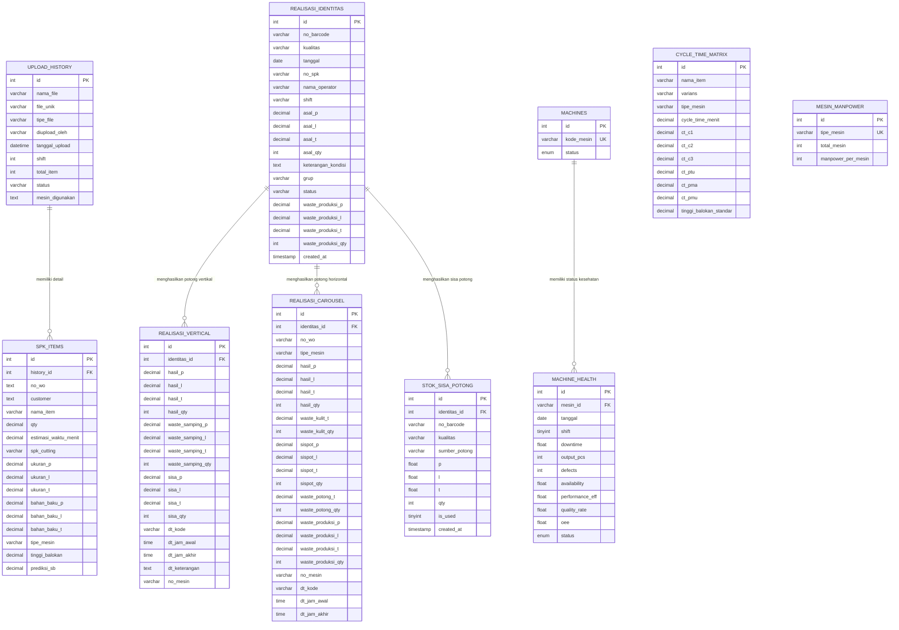
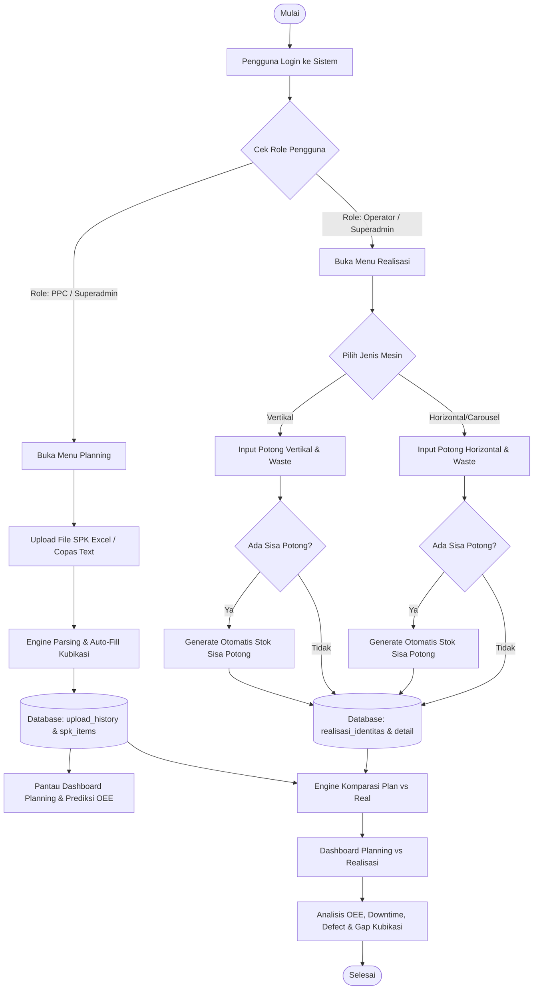
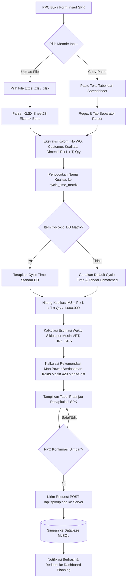
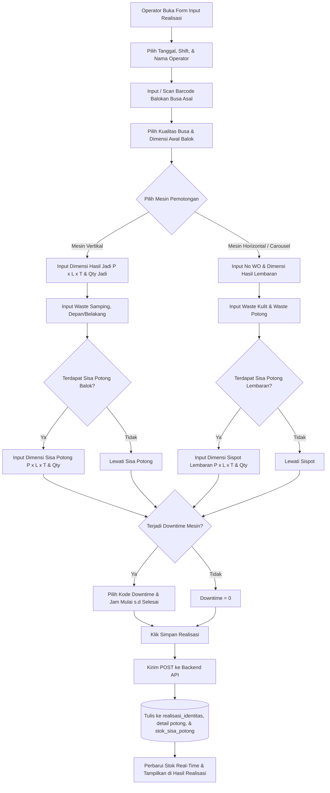
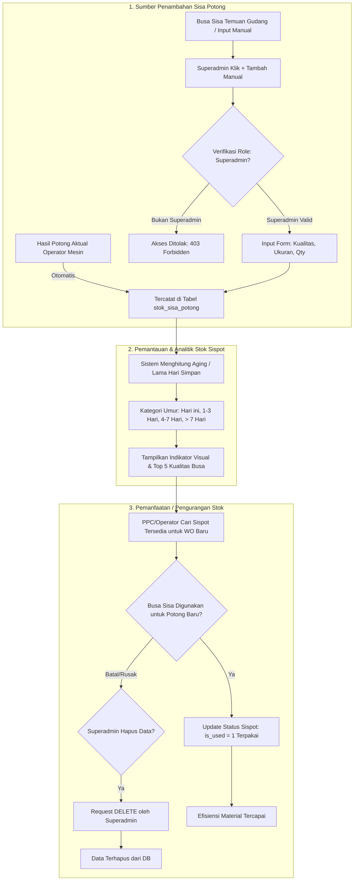

# 📘 DOKUMEN TEKNIS SISTEM (TRD, ERD, DAN FLOWCHART)
## Sistem Perencanaan Produksi & Monitoring Realisasi (Area Busa 2)

**Versi Dokumen:** 1.0  
**Tanggal:** 16 Oktober 2026  
**Lini Produksi:** Area Busa 2 (Mesin Horizontal, Vertikal, Carousel)  
**Status:** Approved / Production-Ready  

Dokumen fisik lengkap telah tersimpan di: [docs/TRD_ERD_FLOWCHART.md](file:///c:/Users/ASUS/OneDrive/Dokumen/MAGANG/Gabungan%20Mesin/Sistem%20Mesin/docs/TRD_ERD_FLOWCHART.md)

---

## 📑 DAFTAR ISI
1. [BAGIAN 1: TECHNICAL REQUIREMENTS DOCUMENT (TRD)](#bagian-1-technical-requirements-document-trd)
   - 1.1 Latar Belakang & Tujuan
   - 1.2 Arsitektur Sistem (High-Level Architecture)
   - 1.3 Tech Stack & Spesifikasi Lingkungan
   - 1.4 Kebutuhan Fungsional per Modul (FR)
   - 1.5 Kebutuhan Non-Fungsional (NFR)
   - 1.6 Desain REST API Endpoints
   - 1.7 Keamanan & Role-Based Access Control (RBAC)
2. [BAGIAN 2: ENTITY RELATIONSHIP DIAGRAM (ERD)](#bagian-2-entity-relationship-diagram-erd)
   - 2.1 Visualisasi ERD (Mermaid Diagram)
   - 2.2 Kamus Data & Relasi Entitas
3. [BAGIAN 3: FLOWCHART SISTEM](#bagian-3-flowchart-sistem)
   - 3.1 Flowchart 1: Alur Kerja Terintegrasi Sistem (Global Workflow)
   - 3.2 Flowchart 2: Alur Proses Perencanaan SPK (PPC Planning)
   - 3.3 Flowchart 3: Alur Proses Realisasi Produksi (Operator Cutting)
   - 3.4 Flowchart 4: Alur Manajemen Siklus Stok Sisa Potong (Sispot Lifecycle)

---

# BAGIAN 1: TECHNICAL REQUIREMENTS DOCUMENT (TRD)

### 1.1 Latar Belakang & Tujuan
Lini produksi **Area Busa 2** bertanggung jawab memotong balokan busa (*polyurethane foam blocks*) menjadi produk setengah jadi maupun produk jadi sesuai pesanan Work Order (WO) pelanggan. Proses pemotongan melibatkan 3 jenis mesin utama:
- **Mesin Horizontal (HRZ):** Pemotongan ketebalan busa lembaran secara mendatar.
- **Mesin Vertikal (VRT):** Pemotongan ukuran panjang dan lebar balok secara tegak.
- **Mesin Carousel (CRS):** Pemotongan berputar kontinyu untuk kapasitas tinggi.

Tujuan teknis sistem ini adalah:
1. Mengotomatiskan konversi pesanan SPK dari dokumen Excel menjadi kebutuhan bahan baku, kubikasi ($m^3$), estimasi waktu siklus (*cycle time*), dan alokasi *man power*.
2. Menyinkronkan target rencana PPC dengan hasil potong aktual operator secara *real-time*.
3. Mengukur efektivitas operasional melalui kalkulasi **OEE (Overall Equipment Effectiveness)**: *Availability*, *Performance*, dan *Quality Rate*.
4. Mengendalikan limbah potongan busa melalui sistem inventori **Stok Sisa Potong (Sispot)** untuk efisiensi biaya material.

---

### 1.2 Arsitektur Sistem (High-Level Architecture)

Sistem menggunakan pola arsitektur **Three-Tier Client-Server Architecture**:
```
+-------------------------------------------------------------+
|                  PRESENTATION LAYER                         |
|     React 19 + Vite 8 + TailwindCSS v4 + Recharts           |
|   (SPA Client: Multi-Role Dashboard & Mobile/PC Friendly)   |
+------------------------------+------------------------------+
                               | HTTP / REST API (JSON)
                               v
+-------------------------------------------------------------+
|                  APPLICATION / BUSINESS LAYER               |
|            Node.js (v18+) + Express 5 REST API              |
|   [Auth RBAC] - [SPK Parser Engine] - [OEE Metric Engine]   |
|   [Realisasi Processor] - [Stock Sisa Potong Controller]     |
+------------------------------+------------------------------+
                               | MySQL Connection Pool (mysql2)
                               v
+-------------------------------------------------------------+
|                      DATA LAYER                             |
|          MySQL 8.x Database (dashboard_vertikal)            |
|   InnoDB Engine, Foreign Keys, UTF8MB4, Timestamped Logs    |
+------------------------------+------------------------------+
```

---

### 1.3 Tech Stack & Spesifikasi Lingkungan

| Layer | Komponen / Library | Versi | Fungsi / Alasan Pemilihan |
| :--- | :--- | :--- | :--- |
| **Frontend** | React | 19.2 | Library antarmuka berbasis komponen modular reaktif. |
| | Vite | 8.2 | Build tool & bundler berkecepatan tinggi dengan HMR instan. |
| | Tailwind CSS | 4.3 | Utility-first styling untuk desain antarmuka modern & dark mode. |
| | Recharts | 3.10 | Pustaka visualisasi grafik (Bar, Line, Pie, Trend Analysis). |
| | Axios | 1.19 | HTTP Client untuk komunikasi API asynchronous. |
| | Lucide React | 1.28 | Ikon antarmuka modern yang konsisten. |
| **Backend** | Node.js | >= 18 LTS | Runtime environment asynchronous event-driven. |
| | Express | 5.2 | Web framework REST API minimalis dan cepat. |
| | mysql2/promise | 3.23 | Driver database MySQL dengan koneksi pooling teroptimasi. |
| | xlsx (SheetJS) | 0.18 | Parser file spreadsheet SPK Excel (`.xls`, `.xlsx`). |
| | Multer | 2.2 | Middleware upload file mutipart/form-data. |
| **Database** | MySQL | 8.0+ | RDBMS ACID-compliant dengan dukungan indexing performa tinggi. |

---

### 1.4 Kebutuhan Fungsional per Modul (FR)

#### FR-01: Modul Autentikasi & RBAC
- Sistem menyediakan login berbasis kredensial (Username & Password).
- Sesi pengguna disimpan pada `localStorage` browser dan dikirim via header request `x-user-role`.
- Tiga level akses:
  - **Superadmin:** Akses penuh ke seluruh menu, CRUD Sisa Potong, dan Master Database.
  - **PPC:** Akses Planning, Insert SPK, OEE Planning, dan View Sisa Potong.
  - **Operator:** Akses Input Realisasi, Log Hasil, OEE Realisasi, dan View Sisa Potong.

#### FR-02: Modul Perencanaan SPK (PPC)
- **Upload File SPK:** Menerima file Excel (`.xls`, `.xlsx`) dan mem-parsing baris WO.
- **Copy-Paste Manual:** Menyediakan input teks langsung untuk paste data tabel dari spreadsheet.
- **Auto-Calculations:**
  - Kubikasi Hasil ($m^3$) = $\frac{P \times L \times T \times Qty}{1.000.000}$
  - Cycle Time Matching: Memetakan nama kualitas busa dan ketebalan ke tabel `cycle_time_matrix`.
  - Prediksi Short Block (SB) dan Estimasi Man Power berdasarkan `mesin_manpower`.
- **Date Filter:** Dashboard planning mendukung peninjauan target tanggal lampau maupun sekarang.

#### FR-03: Modul Realisasi Produksi (Operator)
- Pemilihan jenis mesin (*Vertikal* atau *Horizontal/Carousel*).
- Pencatatan pemotongan aktual: Good Qty, Waste Kulit, Waste Samping, Waste Potong, dan Waste Produksi (Defect).
- Pencatatan Downtime Mesin: Kode kendala, jam awal, jam akhir, dan durasi otomatis dalam jam/menit.
- Ekspor log data hasil pemotongan ke format PDF dan Excel.

#### FR-04: Modul Stok Sisa Potong (Sispot)
- **Otomatisasi:** Setiap potongan sisa yang masih dapat digunakan dari input realisasi otomatis masuk ke tabel `stok_sisa_potong` dengan status `Tersedia` (`is_used = 0`).
- **Analitik Sispot:** Proporsi ketersediaan, Top 5 kualitas busa sisa terbanyak, dan pengelompokan umur simpan (*aging*: Hari ini, 1-3 hari, 4-7 hari, >7 hari).
- **CRUD Superadmin Protection:**
  - Tambah sisa potong manual (*Create*), perbarui dimensi/kualitas (*Update*), dan hapus (*Delete*) **hanya dapat dieksekusi oleh Superadmin** baik di sisi UI maupun verifikasi server (`403 Forbidden` untuk non-superadmin).

#### FR-05: Modul OEE Calculation Engine
- Menghitung efektivitas peralatan dengan rumus standar industri:
  $$\text{Availability} = \frac{\text{Waktu Operasi Bersih}}{\text{Waktu Shift Tersedia}} \times 100\%$$
  $$\text{Performance} = \frac{\text{Output Aktual} \times \text{Ideal Cycle Time}}{\text{Waktu Operasi}} \times 100\%$$
  $$\text{Quality} = \frac{\text{Total Output} - \text{Defect Output}}{\text{Total Output}} \times 100\%$$
  $$\text{OEE Score} = \text{Availability} \times \text{Performance} \times \text{Quality}$$
- Menyediakan grafik tren OEE 7 hari terakhir dengan batas ambang minimum efisiensi (*threshold*) 80%.

---

### 1.5 Kebutuhan Non-Fungsional (NFR)

| Kategori | Spesifikasi & Standar Target |
| :--- | :--- |
| **Performa** | Waktu respon API rata-rata $\le 200\text{ ms}$; loading dashboard $\le 1.5\text{ detik}$. |
| **Kapasitas** | Mendukung hingga $\ge 1.000.000$ transaksi baris potong dengan pengindeksan MySQL (*B-Tree index* pada `no_barcode`, `tanggal`, `is_used`, `identitas_id`). |
| **Keamanan** | Server-side validation pada header `x-user-role`; sanitasi input SQL parameterized query anti SQL Injection. |
| **Reliabilitas** | MySQL Connection Pool mengelola sambungan database secara otomatis tanpa *memory leak*. |
| **User Experience** | Transisi halaman halus (*page fade slide*), accordion submenu berbasis CSS Grid natural, dan responsif terhadap perangkat desktop/tablet. |

---

### 1.6 Desain REST API Endpoints

| Method | Endpoint | Fungsi | Hak Akses |
| :--- | :--- | :--- | :--- |
| `POST` | `/api/spk/upload` | Upload & parsing file SPK Excel | PPC, Superadmin |
| `POST` | `/api/spk/manual` | Simpan data SPK hasil input manual/copas | PPC, Superadmin |
| `GET` | `/api/spk/efisiensi` | Ambil data kalkulasi OEE Planning per tanggal | Semua Role |
| `GET` | `/api/spk/chart` | Ambil histori kubikasi & tren SPK harian | Semua Role |
| `GET` | `/api/realisasi` | Ambil seluruh data transaksi realisasi | Semua Role |
| `POST` | `/api/realisasi/vertical` | Simpan transaksi pemotongan mesin vertikal | Operator, Superadmin |
| `POST` | `/api/realisasi/carousel` | Simpan transaksi pemotongan horizontal/carousel | Operator, Superadmin |
| `GET` | `/api/realisasi/sisa-potong/all` | Ambil semua data inventori sisa potong | Semua Role |
| `POST` | `/api/realisasi/sisa-potong` | Tambah manual sisa potong | **Khusus Superadmin** |
| `PUT` | `/api/realisasi/sisa-potong/:id` | Update data sisa potong | **Khusus Superadmin** |
| `DELETE` | `/api/realisasi/sisa-potong/:id` | Hapus data sisa potong | **Khusus Superadmin** |
| `GET` | `/api/matrix` | Ambil data master cycle time matrix | Semua Role |
| `POST` | `/api/matrix` | Tambah/update master cycle time | **Khusus Superadmin** |

---

# BAGIAN 2: ENTITY RELATIONSHIP DIAGRAM (ERD)

### 2.1 Visualisasi ERD



---

### 2.2 Kamus Data & Relasi Entitas

1. **`upload_history` ke `spk_items` (One-to-Many - 1:N)**:
   - Satu sesi unggah dokumen SPK (`upload_history.id`) memuat banyak rincian baris pesanan Work Order (`spk_items.history_id`).
   - *Cascading Delete:* Jika dokumen unggah dihapus, rincian SPK ikut terhapus.
2. **`realisasi_identitas` ke `realisasi_vertical` / `realisasi_carousel` (One-to-Many - 1:N)**:
   - `realisasi_identitas` adalah entitas induk (header) balok busa asal (barcode induk, dimensi awal, operator, shift).
   - Satu balok busa asal dapat dipotong menjadi beberapa ukuran hasil jadi vertikal atau horizontal/carousel.
3. **`realisasi_identitas` ke `stok_sisa_potong` (One-to-Many - 1:N)**:
   - Potongan busa sisa yang memiliki nilai guna dicatat ke `stok_sisa_potong` dengan referensi `identitas_id`.
   - Untuk data yang ditambahkan manual oleh Superadmin, `identitas_id` bernilai `NULL`.
4. **`machines` ke `machine_health` (One-to-Many - 1:N)**:
   - Memantau metrik performa dan riwayat kesehatan harian per mesin berdasarkan `kode_mesin`.

---

# BAGIAN 3: FLOWCHART SISTEM

### 3.1 Flowchart 1: Alur Kerja Terintegrasi Sistem (Global Workflow)



---

### 3.2 Flowchart 2: Alur Proses Perencanaan SPK (PPC Planning)



---

### 3.3 Flowchart 3: Alur Proses Realisasi Produksi (Operator Cutting)



---

### 3.4 Flowchart 4: Alur Manajemen Siklus Stok Sisa Potong (Sispot Lifecycle)


